<p align="center">
  
</p>

<h1 align="center">Lumvane</h1>

<p align="center">
  Прокси-клиент для Windows и Android на sing-box и Xray-core.<br>
  Proxy client for Windows and Android built on sing-box and Xray-core.
</p>

<p align="center">
  <a href="#русский">Русский</a> | <a href="#english">English</a>
</p>

# Русский

Lumvane управляет профилями прокси, подписками и маршрутизацией и запускает их через ядро sing-box со встроенным Xray-core. Есть две версии с общим ядром и общим форматом данных: настольная для Windows и мобильная для Android.

## Возможности

- Протоколы: SOCKS, HTTP, Shadowsocks, VMess, VLESS (в том числе Reality и XHTTP через Xray), Trojan, Hysteria и Hysteria2, TUIC, Juicity, TrustTunnel, AnyTLS, ShadowTLS, Mieru, SSH, WireGuard и AmneziaWG, Tailscale, naive (только Windows), цепочки прокси, произвольный JSON sing-box или Xray.
- Импорт: ссылки, QR-коды, подписки с автообновлением, Clash YAML, JSON sing-box, SIP008, `.conf` WireGuard.
- Маршрутизация: профили правил, тысячи готовых rule-set с зеркалами, встроенные шаблоны для России, Китая и Ирана. Профилем можно поделиться ссылкой `lumvane://route/`, удалённые профили обновляются по URL.
- Автовыбор: группа профилей переключается на лучший рабочий сервер, выбранный профиль остаётся в приоритете.
- Обход блокировок: фрагментация TLS ClientHello, SNI в смешанном регистре, на Windows ещё подмена TLS (TLS spoof).
- Статистика трафика по профилям и приложениям, список активных соединений, проверка задержки и скорости.
- Предупреждения, когда подписка скоро истекает или трафик почти исчерпан.
- Интерфейс на русском и английском, светлая и тёмная темы.

**Windows**: режим Tun или системный прокси, системный DNS, трей с выбором профиля, глобальные горячие клавиши, автозапуск, ссылки `lumvane://`.

**Android**: VPN без root, прокси для отдельных приложений, плитка быстрых настроек, запуск после загрузки и Always-on VPN, импорт базы `lumvane.db` из Windows-версии. Пароли и ключи хранятся зашифрованными в Android Keystore.

## Скриншоты

### Windows

<p align="center">
  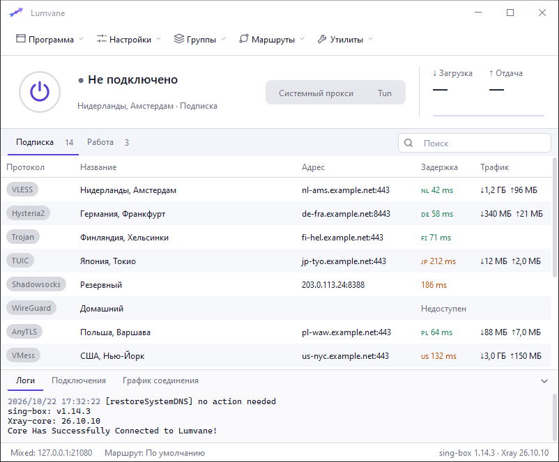
  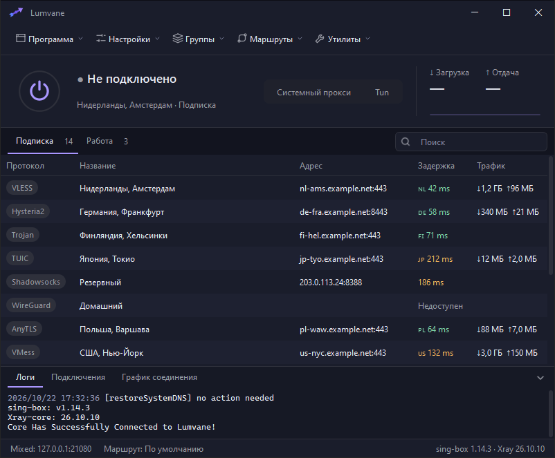
</p>
<p align="center">
  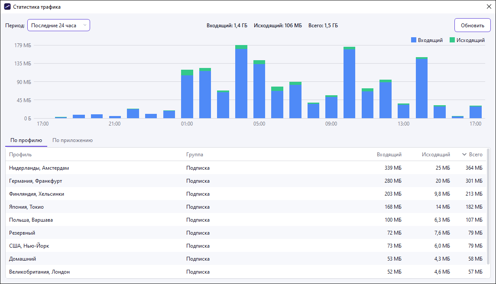
  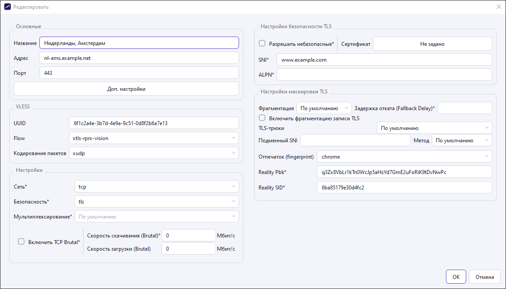
</p>

### Android

<p align="center">
  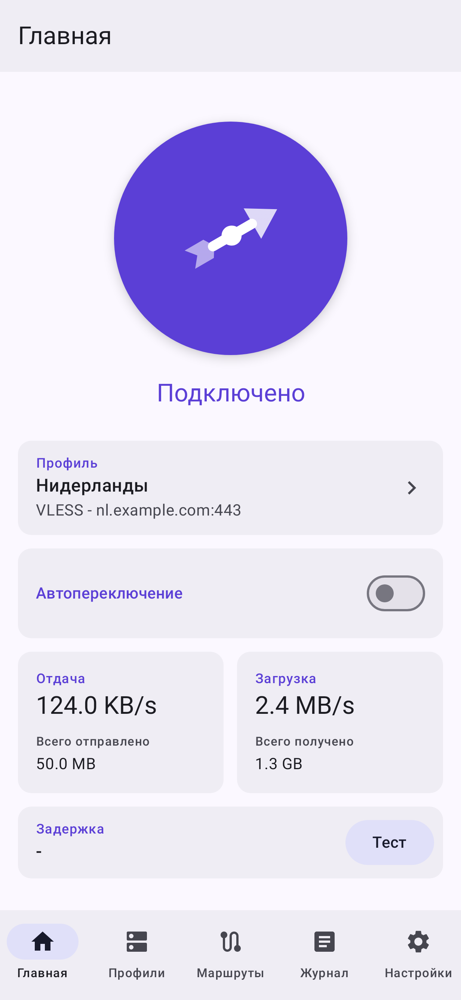
  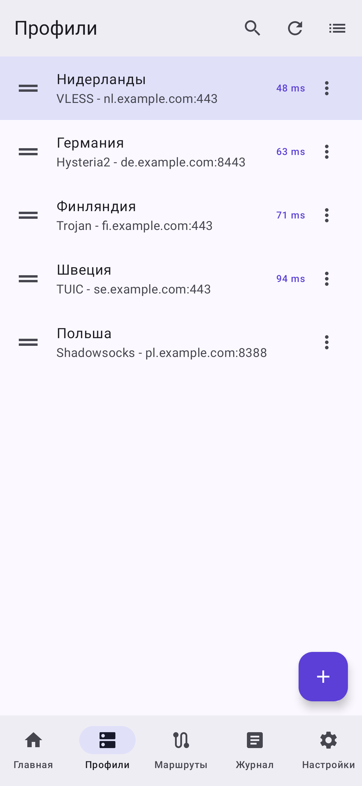
  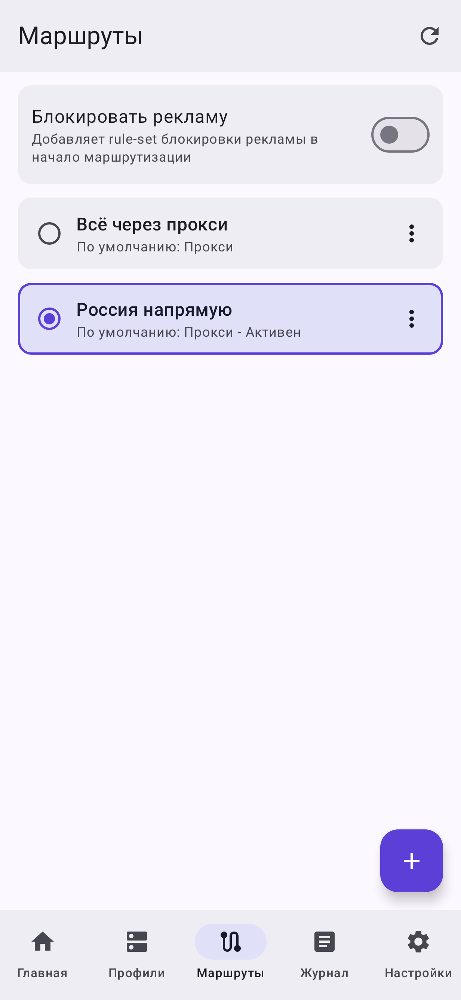
  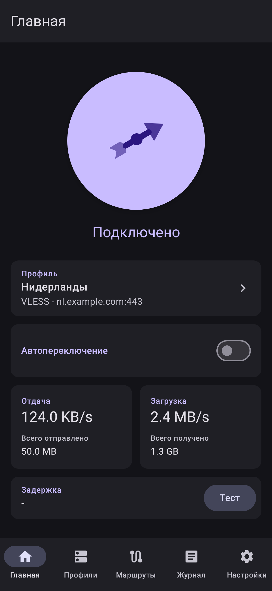
</p>

## Установка

Готовые сборки лежат на странице [Releases](../../releases):

- `Lumvane-windows-x64.zip`: распакуйте в любую папку и запустите `Lumvane.exe`. Для режима Tun нужны права администратора, приложение запросит их само.
- `Lumvane-android-arm64.apk`: Android 8.0 и новее, большинство телефонов. Для старых 32-битных устройств есть `armeabi-v7a`.

## Структура репозитория

| Папка | Что внутри |
|---|---|
| `windows/` | клиент для Windows: Qt 6, C++, CMake |
| `android/` | клиент для Android: Kotlin, Jetpack Compose, Gradle |
| `core/windows/` | ядро для Windows (`LumvaneCore.exe`): Go, gRPC к интерфейсу через именованный канал |
| `core/android/` | ядро для Android (`lumcore.aar`): Go, gomobile |
| `core/shared/` | общий Go-код двух ядер |
| `core/third_party/` | общие для обеих платформ форки sing-box и wireguard-go с нашими правками; `diff_upstream.ps1` показывает правки относительно upstream |
| `testdata/` | общие тестовые данные: одни и те же ссылки и маршруты проверяют обе версии |
| `design/` | иконка и её генераторы |

## Сборка

### Windows

Нужны Windows 10 или 11, Visual Studio 2022 Build Tools (нагрузка "Разработка классических приложений на C++") и Go 1.27. CMake, Ninja, protoc и Qt 6.8.3 (MSVC 2022 x64) кладутся в `windows/.toolchain`: `cmake-*`, `ninja`, `protoc`, `Qt`.

```
powershell -ExecutionPolicy Bypass -File windows\build_windows.ps1
```

Результат: `windows\deploy\Lumvane\` с `Lumvane.exe`, `LumvaneCore.exe` и библиотеками Qt. Флаг `-SkipGo` пересобирает только интерфейс, `-SkipCpp` только ядро, `-Tests` собирает и запускает тесты интерфейса (с `-SkipGo -SkipCpp` только тесты). Тесты ядер: `go test` в `core/shared`, `core/windows` и `core/android`.

### Android

Нужны JDK 21, Android SDK 35, NDK 27 и Go 1.27, переменные `JAVA_HOME` и `ANDROID_HOME`.

```
powershell -File core\android\build_aar.ps1          # ядро -> android\app\libs\lumcore.aar
powershell -File android\build.ps1                   # отладочные APK
powershell -File android\build.ps1 testDebugUnitTest # тесты
powershell -File android\build.ps1 assembleRelease   # релизные APK
powershell -File android\build.ps1 screenshots       # скриншоты экранов -> docs\screenshots
```

Скриншоты не требуют телефона или эмулятора: Robolectric отрисовывает настоящие экраны Compose с тестовыми данными, Roborazzi сохраняет их в PNG.

APK появляются в `android\app\build\outputs\apk\`. Чтобы подписать релиз, укажите в `android\local.properties` строку `lumvane.signing=<путь к .properties>` с полями `storeFile`, `storePassword`, `keyAlias`, `keyPassword`. Без неё релиз собирается неподписанным.

## Лицензия

[GNU GPL v3](LICENSE). Сторонние компоненты и их лицензии перечислены в [THIRD_PARTY_NOTICES.md](THIRD_PARTY_NOTICES.md).

# English

Lumvane manages proxy profiles, subscriptions and routing and runs them on the sing-box core with Xray-core built in. There are two apps with a shared core and data format: a desktop one for Windows and a mobile one for Android.

## Features

- Protocols: SOCKS, HTTP, Shadowsocks, VMess, VLESS (including Reality and XHTTP through Xray), Trojan, Hysteria and Hysteria2, TUIC, Juicity, TrustTunnel, AnyTLS, ShadowTLS, Mieru, SSH, WireGuard and AmneziaWG, Tailscale, naive (Windows only), proxy chains, custom sing-box or Xray JSON.
- Import: share links, QR codes, auto-updating subscriptions, Clash YAML, sing-box JSON, SIP008, WireGuard `.conf`.
- Routing: rule profiles, thousands of ready rule-sets with mirrors, built-in presets for Russia, China and Iran. A profile can be shared as a `lumvane://route/` link; remote profiles update from a URL.
- Auto selection: a group of profiles switches to the best working server while the chosen profile keeps priority.
- Censorship circumvention: TLS ClientHello fragmentation, mixed-case SNI, and TLS spoofing on Windows.
- Traffic statistics per profile and per app, a list of active connections, latency and speed tests.
- Warnings when a subscription is about to expire or its traffic is nearly used up.
- Russian and English interface, light and dark themes.

**Windows**: Tun mode or system proxy, system DNS, tray with a profile picker, global hotkeys, autostart, `lumvane://` links.

**Android**: VPN without root, per-app proxy, Quick Settings tile, start on boot and Always-on VPN, import of the `lumvane.db` database from the Windows app. Passwords and keys are stored encrypted with the Android Keystore.

## Screenshots

### Windows

<p align="center">
  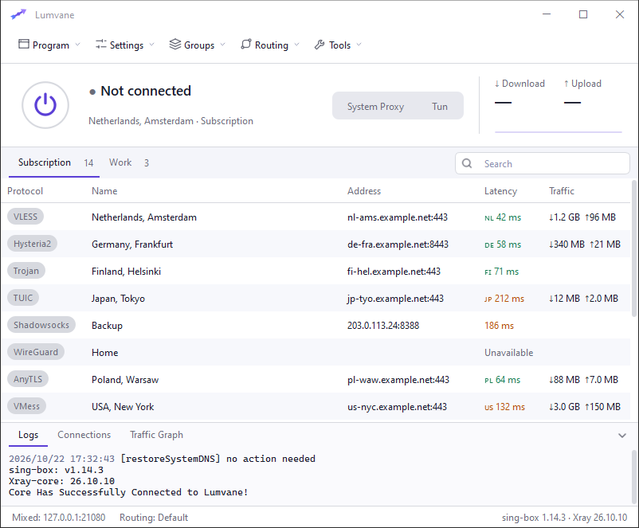
  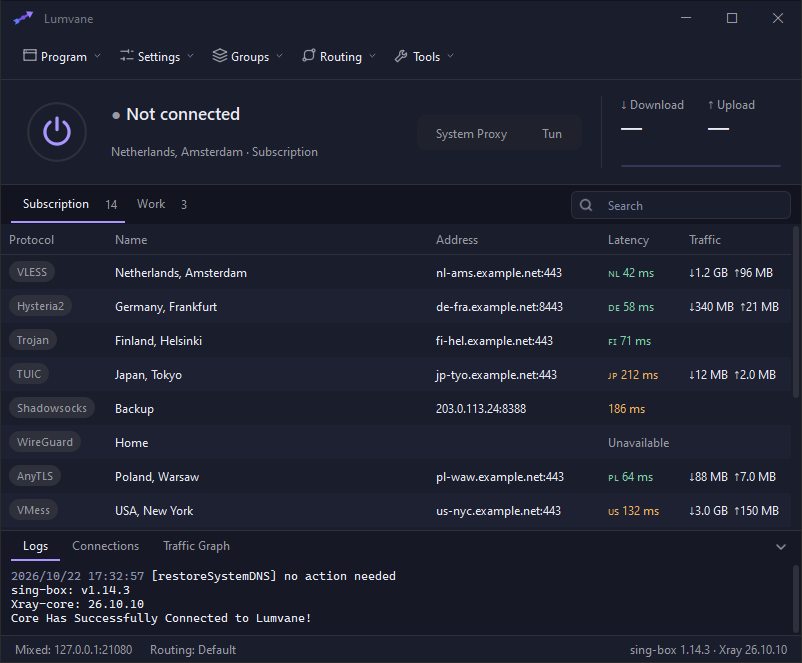
</p>
<p align="center">
  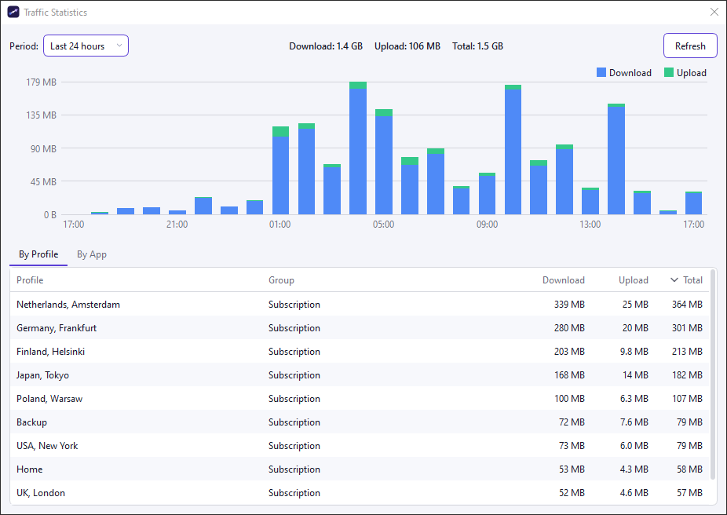
  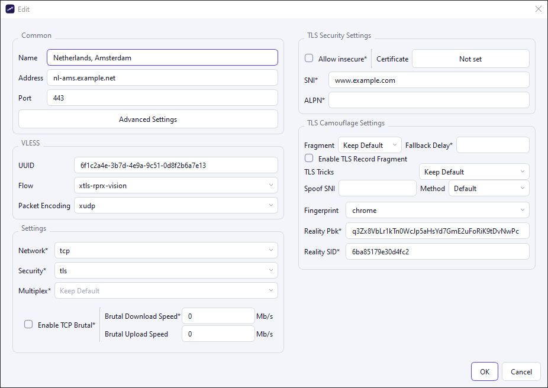
</p>

### Android

<p align="center">
  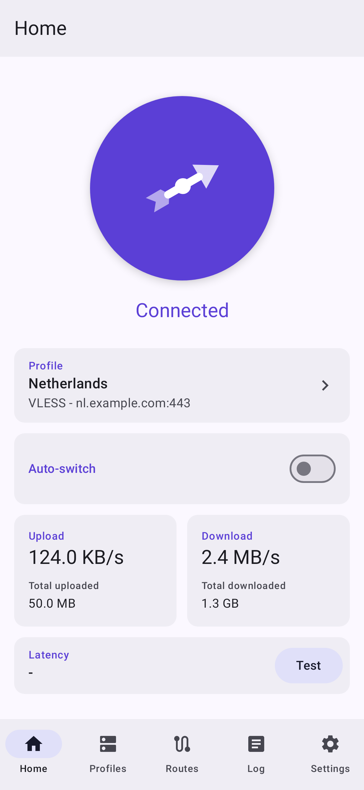
  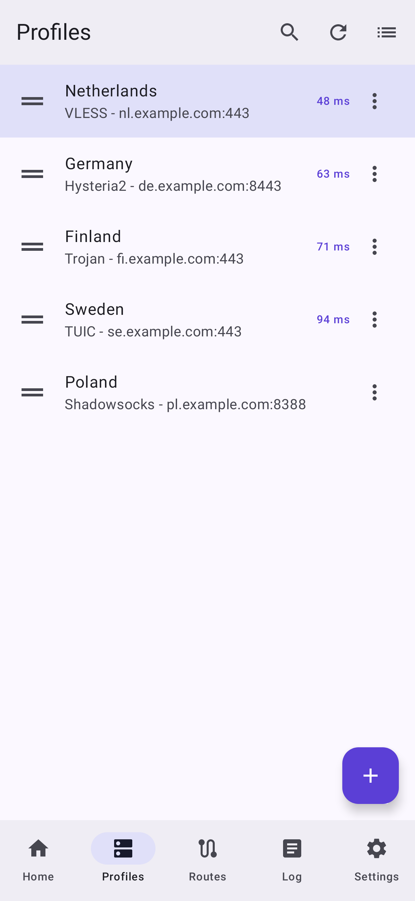
  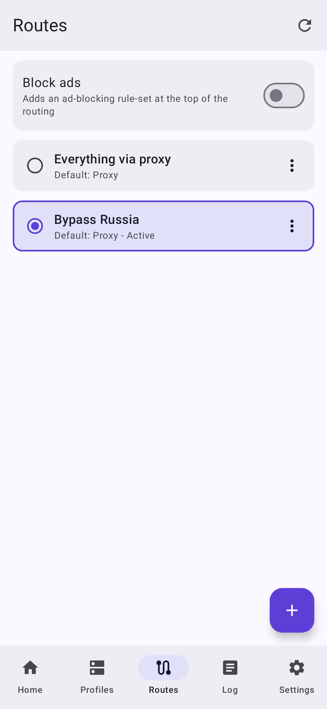
  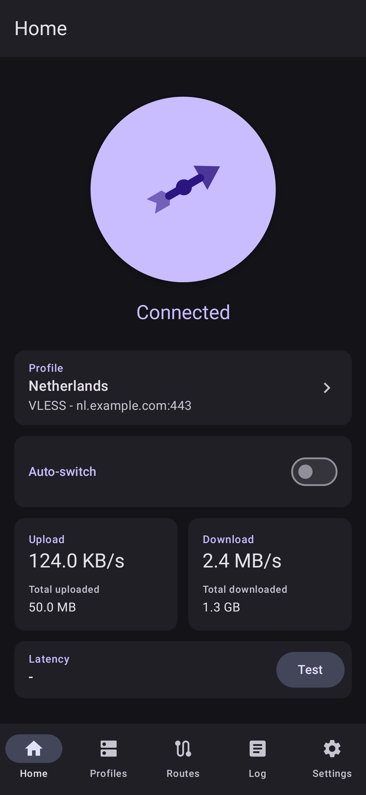
</p>

## Installation

Ready builds are on the [Releases](../../releases) page:

- `Lumvane-windows-x64.zip`: unpack anywhere and run `Lumvane.exe`. Tun mode needs administrator rights; the app asks for them itself.
- `Lumvane-android-arm64.apk`: Android 8.0 or newer, most phones. Older 32-bit devices use `armeabi-v7a`.

## Repository layout

| Folder | Contents |
|---|---|
| `windows/` | Windows client: Qt 6, C++, CMake |
| `android/` | Android client: Kotlin, Jetpack Compose, Gradle |
| `core/windows/` | Windows core (`LumvaneCore.exe`): Go, gRPC to the GUI over a named pipe |
| `core/android/` | Android core (`lumcore.aar`): Go, gomobile |
| `core/shared/` | Go code shared by both cores |
| `core/third_party/` | sing-box and wireguard-go forks with our patches, shared by both platforms; `diff_upstream.ps1` shows the patches against upstream |
| `testdata/` | shared test data: the same links and routes are checked by both clients |
| `design/` | the icon and its generators |

## Building

### Windows

Requires Windows 10 or 11, Visual Studio 2022 Build Tools (workload "Desktop development with C++") and Go 1.27. CMake, Ninja, protoc and Qt 6.8.3 (MSVC 2022 x64) go to `windows/.toolchain`: `cmake-*`, `ninja`, `protoc`, `Qt`.

```
powershell -ExecutionPolicy Bypass -File windows\build_windows.ps1
```

Output: `windows\deploy\Lumvane\` with `Lumvane.exe`, `LumvaneCore.exe` and the Qt runtime. `-SkipGo` rebuilds only the GUI, `-SkipCpp` only the core, `-Tests` builds and runs the GUI tests (with `-SkipGo -SkipCpp`, only the tests). Core tests: `go test` in `core/shared`, `core/windows` and `core/android`.

### Android

Requires JDK 21, Android SDK 35, NDK 27 and Go 1.27, with `JAVA_HOME` and `ANDROID_HOME` set.

```
powershell -File core\android\build_aar.ps1          # core -> android\app\libs\lumcore.aar
powershell -File android\build.ps1                   # debug APKs
powershell -File android\build.ps1 testDebugUnitTest # tests
powershell -File android\build.ps1 assembleRelease   # release APKs
powershell -File android\build.ps1 screenshots       # screen captures -> docs\screenshots
```

Screenshots need no phone or emulator: Robolectric renders the real Compose screens with sample data and Roborazzi saves them as PNG.

APKs land in `android\app\build\outputs\apk\`. To sign the release, add `lumvane.signing=<path to .properties>` to `android\local.properties`, with the fields `storeFile`, `storePassword`, `keyAlias`, `keyPassword`. Without it the release is built unsigned.

## License

[GNU GPL v3](LICENSE). Third-party components and their licenses are listed in [THIRD_PARTY_NOTICES.md](THIRD_PARTY_NOTICES.md).
